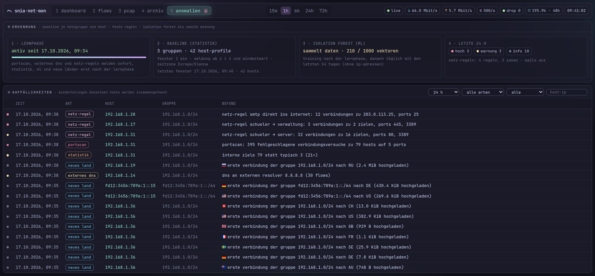

# Features

**English** · [Deutsch](FEATURES_de.md)

What Snia-Net-Mon does in detail and how. The focus is on [anomaly detection](#anomaly-detection), including the maths
behind it. Installation and configuration keys are in [INSTALL.md](INSTALL.md), the overview is in the
[README](README.md).

The web UI and the texts of the findings are in German. Where this document quotes them, an English translation follows
in parentheses.

- [Overview](#overview)
- [Download / upload (traffic direction)](#download--upload-traffic-direction)
- [Upload alert](#upload-alert)
- [Anomaly detection](#anomaly-detection)
  - [Process](#process)
  - [Features per host and window](#features-per-host-and-window)
  - [Statistics against the baseline](#1-statistics-against-the-baseline)
  - [Isolation Forest](#2-isolation-forest)
  - [Fixed rules: port scan, external DNS, new country](#3-fixed-rules-port-scan-external-dns-new-country)
  - [Beaconing](#4-beaconing)
  - [Network rules](#network-rules)
  - [Learning phase, merging, timeline, mails](#learning-phase-merging-timeline-mails)
  - [Tuning in practice](#tuning-in-practice)
- [Architecture](#architecture)
- [Performance at high packet rates](#performance-at-high-packet-rates)
- [Pre-aggregation](#pre-aggregation-statistics-with-heavy-traffic)
- [Storage: one SQLite file per hour](#storage-one-sqlite-file-per-hour)
- [Retention](#retention-live--history--archive)
- [API](#api)
- [Limits & next steps](#limits--next-steps)

## Overview

| Area | What it does |
|---|---|
| **Dashboard** (`#dashboard`) | Live throughput split into **download ↓ and upload ↑** (mirrored chart) via WebSocket, traffic direction in the time range, table of active connections with direction (freezable, filterable). **Selecting a range in the throughput chart with the mouse** pauses chart and table and shows the connections of exactly that period (click or Esc = back to live), top talkers, top ports, **countries and networks (ASN)** of the peers, protocol distribution, Sankey diagram source → service → destination. All statistics can be filtered by direction |
| **Flow search** (`#flows`) | Filter by IP **or CIDR** (source/destination/both), port, protocol, direction, time range; CSV export. Below that the **top talkers as a graph** with their strongest peers (service, sent/received). Clicking an IP in the dashboard jumps straight here |
| **PCAP** (`#pcap`) | Upload a capture file (pcap/pcapng, e.g. from tcpdump, Wireshark or the firewall's packet capture) by drag & drop: key figures, timeline, protocols, **applications** (YouTube, Microsoft 365, CDN, AI … via TLS SNI, DNS, HTTP host, IP prefixes), **endpoints with country and ASN**, countries, top sources/ports/flows, DNS, HTTP, TCP flags and heuristic **anomalies** (port scan, NXDOMAIN clusters, DNS/HTTP on non-standard ports). History of analyses; clicking an IP searches for it in the NetFlow data |
| **Archive** (`#archive`) | Fill level of the history, list of archives with period, size and deletion date. **Search the history or an archive**: opens the flow search with this data source (only what a query needs is unpacked from archives) |
| **Anomalies** (`#anomalies`) | Statistics against a baseline per network group and host, Isolation Forest as a second opinion, port scan, DNS to external resolvers, first country of a group, beaconing, network rules between zones. Status of the learning phase and the model, **timeline** (active anomalies per hour or day by severity, clicking a bar filters the list), history of anomalies (30 days) with filters. External IPs are shown with country and provider, clicking the host opens the flow search. See [anomaly detection](#anomaly-detection) |
| **GeoIP** | Country, organisation and ASN for all public IPs – in the live table, flow search (also CSV), top talkers, Sankey, anomalies and PCAP analysis |
| **Retention** | live 48 h (at most 72 h) → history up to 50 GB → zstd archive, deleted 90 days after the newest flow; see [retention](#retention-live--history--archive). PCAP analyses follow the live window, the uploaded file itself is deleted right after the analysis |
| **Excluded networks** | `network.exclude_networks`: traffic from or to these networks is discarded on reception – not stored, not shown, not counted |
| **Upload alert** | if a connection uploads more than 1 GiB to the outside, the admins get a mail (source, destination with country/ASN, service, volume, duration, rate) |

Keyboard as in Hyprland: **Alt+1 … Alt+5** switches the workspace. Focus follows the mouse: the window under the pointer
gets the active gradient border.

## Download / upload (traffic direction)

Every flow gets a direction on reception. It is based on the list of internal networks (`network.local_networks`):

| Direction | Meaning | Example |
|---|---|---|
| `in` ↓ download | external → internal | response from a web server, port scan against a forwarded server |
| `out` ↑ upload | internal → external | client request, cloud backup |
| `internal` ⇄ | internal ↔ internal | SMB between LAN and server VLAN |
| `external` | neither | should be rare; often a sign that one of your own networks is missing from the list |

Most exporters (e.g. softflowd) report each connection as two flows (request and response). A download therefore shows
up as a large `in` flow plus a small `out` flow. The service (top ports, Sankey, column "Dienst") is always the smaller of
the two ports, i.e. 443 and not the random client port.

By default the private ranges (RFC 1918, CGNAT, link-local, IPv6 ULA) count as internal. With **public IPv6** from the
provider, its prefix must be added to `local_networks`, otherwise IPv6 traffic is classified as "external". The same
applies to the exporter's public address (e.g. the firewall's WAN address) if connections to it should count as
download. The direction is stored on reception, so a changed list only affects new flows.

### Excluded networks

Networks in `network.exclude_networks` (CIDR or single IP) are discarded by the collector right after parsing as soon as
**source or destination** lies within them. They end up neither in the database nor in the live view and do not count
for the upload alert. Typical: a backup server whose nightly uploads should not trigger an alert, or a guest WLAN. The
counter `collector.excluded_flows` under `/api/status` shows how much was discarded. Flows already stored are not
changed.

## Upload alert

Exporters report a long connection several times (once per active timeout, `maxlife` in softflowd). The alert therefore
sums the outgoing bytes (direction `out`) per **connection** (source, destination, ports, protocol) across all its flows.
When `upload_threshold_mb` is exceeded, **one** mail goes to `email.admins` with source, destination (country, ASN),
service, volume, start, duration and rate. The connection is not reported again afterwards. Without new flows for
`session_idle_secs` it counts as finished. An upload spread over many parallel connections (some cloud clients) only
triggers the alert if a single connection reaches the threshold – such cases are more likely caught by the statistics of
the anomaly detection. Every alert is also written to the log (`WARN alert::upload`), even without mail delivery or when
`max_mails_per_hour` is reached.

## Anomaly detection



*Test environment with flowgen traffic, 1-minute windows, no learning phase and the rules from the
[example below](#network-rules) (plus SSH allowed). The anomalies were injected on purpose. A student PC scans the server
network: this produces the port scan, a statistical hit (79 instead of typically 3 internal peers) and a violation of
"schueler → server". The many "neues land" (new country) entries only appear because the learning phase is disabled
here.*

Every ten minutes, the detection answers one question for each internal host: *Is it behaving differently from usual –
or differently from the devices in its network at this time?* Several methods complement each other:

| Method | What it reports | Severity |
|---|---|---|
| **Statistics** (baseline) | A feature is at least `z_threshold` standard deviations above typical **and** reaches the minimum (e.g. 100 MB upload per window). Text e.g. "upload 3.0 GiB statt typisch 38 MiB (80×)" (instead of typically) | warn; high if the Isolation Forest agrees or twice the threshold is reached |
| **Isolation Forest** (ML) | Gives each host window a score. For statistical hits it is shown as a second opinion ("ml 0.81 ✓ stimmt zu", agrees). On its own it reports unusual *combinations* where each single value is normal, along with the strongest deviations | info |
| **Port scan** | at least `scan_threshold` failed TCP connection attempts (SYN without ACK) to distinct destination/port pairs, also within the LAN | high |
| **External DNS** | DNS (53/853) to a resolver outside that is not listed in `dns_servers` | warn |
| **New country** | first connection of a network group to a country it has never contacted before | info |
| **Beaconing** | a host calls the same external destination at almost equal intervals, like malware calling its command server | info, never by mail |
| **Network rule** | connection between zones that should be reported according to the [network rules](#network-rules), e.g. student network → administration | per rule, default high |

### Process

```text
Collector ──flows──▶ window (10 min, aligned to the clock: 10:00, 10:10 …)
                       │  per flow: determine internal host, increase counters,
                       │  check network rules, remember connection start for beaconing
                       ▼
               window finished (checked every 5 s)
                       │
   ┌───────────────────┼───────────────────────────┬──────────────────────┐
   ▼                   ▼                           ▼                      ▼
statistics        Isolation Forest            fixed rules              beaconing
(baseline)        (score per host)      (scan, DNS, new country,   (12 h connection
   │                   │                     network rules)          history per pair)
   └──────── compare, then update baseline ──────────────┴──────────────────────┘
                       │
                       ▼
          merge (same kind, same host, < 1 h) ──▶ anomaly.db ──▶ web UI, log, optionally mail
```

Windows start at multiples of the window length (with 10 minutes: on the hour, ten past, etc.). If the program starts in
the middle of a window (more than 10 % after its start), the window would be incomplete and the values too small. Such a
window only goes through the fixed rules and does not feed into statistics, baseline and training. The evaluation runs
in its own thread and does not hold up reception.

### Features per host and window

Every flow is assigned to the internal host that **causes** it: for upload (`out`) and internal traffic the source, for
download (`in`) the destination. Traffic without an internal party (`external`) and hosts in `anomaly.ignore` are not
counted. Seven raw values are produced per host and window:

| No. | Feature | What is counted | Minimum for a report |
|---|---|---|---|
| 1 | **upload** | bytes of `out` flows | 100 MiB (`min_upload_mb`) |
| 2 | **download** | bytes of `in` flows | 1 GiB (`min_download_mb`) |
| 3 | **flows** | flows sent by the host itself (`out` and `internal`) | 1000 (`min_flows`) |
| 4 | **external peers** | distinct external peers | 100 (`min_peers`) |
| 5 | **internal peers** | distinct internal peers | 50 (`min_internal_peers`) |
| 6 | **ports** | distinct services (the smaller port of each flow) | 30 (`min_ports`) |
| 7 | **countries** | distinct countries of the external peers | 10 (`min_countries`) |

In addition, the window collects the raw data of the fixed rules (failed TCP attempts, DNS to external resolvers,
network rule violations) and the start times of outgoing connections for beaconing. Sets such as "distinct peers" are
capped at 50,000 per host so that a scan across a whole network does not blow up memory – no threshold needs more.

The **minimums** prevent reports that are statistically correct but of no interest to anyone: a printer that suddenly
uploads 20 MB instead of 1 MB is 20 times as active as usual, but not a security problem.

### 1. Statistics against the baseline

#### Log scale

Network traffic is extremely skewed: most windows of a host have a few hundred kilobytes, a few have several gigabytes.
Mean and standard deviation of the raw values would be dominated by the few large values. The calculation is therefore
done on logarithmic values:

```math
y = \ln(1 + x)
```

The `+1` makes `x = 0` (e.g. no upload) map to `y = 0` instead of minus infinity. On the log scale, **factors become
distances**: a host loading ten times as much as usual is always `ln 10 ≈ 2.3` above its typical value – no matter
whether it is 10 MB instead of 1 MB or 10 GB instead of 1 GB. The distribution becomes roughly symmetric, and mean and
standard deviation become meaningful.

#### Moving mean and moving variance (EWMA)

For each feature and each time slot (see below) the baseline stores only three numbers: the number of samples `n`, the
mean `μ` and the variance `σ²`. Each new measurement `y` is incorporated like this:

```math
\begin{aligned}
n &\leftarrow n + 1, \qquad \alpha = \max\left(\frac{1}{n},\ 0.002\right) \\
d &= y - \mu \\
\mu &\leftarrow \mu + \alpha \, d \\
\sigma^2 &\leftarrow (1 - \alpha)\left(\sigma^2 + \alpha \, d^2\right)
\end{aligned}
```

These are two methods in one:

- **Learning phase of a slot** (`n ≤ 500`, i.e. `α = 1/n`): the formulas give **exactly** the arithmetic mean and the
  population variance of all measurements so far (a form of Welford's algorithm, numerically stable, without storing the
  measurements themselves). For the values 2, 4, 4, 4, 5, 5, 7, 9 the result is `μ = 5`, `σ² = 4` – a test checks this.
- **Afterwards** (`α = 0.002`): an **exponentially weighted** moving average (EWMA). The measurement from `k` steps ago
  has weight `α (1 − α)^k`. The memory thus covers about `1/α = 500` samples; after `ln 2 / α ≈ 350` samples a
  measurement only counts half as much. This way the baseline adapts slowly when the network changes (new software, more
  devices), but does not forget everything after a few hours.

#### Minimum standard deviation

Some slots are very uniform – a server that does almost exactly the same amount every night at 3 am. There `σ` would be
close to zero and even a tiny deviation a huge z-score. Hence a lower bound:

```math
\hat\sigma = \max\left(\sqrt{\sigma^2},\ 0.5\right)
```

#### Z-score and threshold

For the current measurement `y` of a feature against the reference profile:

```math
z = \frac{y - \mu}{\hat\sigma}
```

A feature is reported if **both** conditions hold:

```math
z \ge z_{\text{thr}} \quad \text{and} \quad x \ge x_{\min}
```

Only deviations **upwards** count. A host doing less than usual is of no interest for security.

**What does `z_threshold = 4` mean in factors?** With the typical value `t = e^μ − 1` the condition can be rewritten:

```math
z \ge z_{\text{thr}}
\iff \ln(1+x) - \ln(1+t) \ge z_{\text{thr}} \cdot \hat\sigma
\iff \frac{1+x}{1+t} \ge e^{\,z_{\text{thr}} \cdot \hat\sigma}
```

At the smallest spread `σ̂ = 0.5` this means: at least `e² ≈ 7.4` times as much as typical. If a slot varies more
(`σ̂ = 1`), it already takes `e⁴ ≈ 55` times as much. The threshold thus adapts by itself: where things are always wild,
they have to get wilder before anything is reported.

Because of the log scale, the displayed **typical value** `t = e^μ − 1` is the geometric mean (more precisely: of
`1 + x`, then minus 1). It is closer to the median than the arithmetic mean and is hardly distorted by single large
windows. The displayed factor is `(x + 1) / (t + 1)`.

**Worked example:** a server typically uploads 38 MiB per window, the spread of its slot is `σ̂ = 0.6`.

```math
\mu = \ln(1 + 38 \cdot 2^{20}) \approx 17.50
```

Now it uploads 3 GiB:

```math
y = \ln(1 + 3 \cdot 2^{30}) \approx 21.89,
\qquad z = \frac{21.89 - 17.50}{0.6} \approx 7.3
```

`z ≥ 4` and 3 GiB ≥ 100 MiB: report "upload 3.0 GiB statt typisch 38 MiB (81×)". Since `z < 2 · 4 = 8`, the severity is
**warn** – unless the Isolation Forest agrees, then **high**.

**Order:** first compare, then incorporate the measurement into the baseline. The current window therefore does not
influence its own comparison. If several features hit, the one with the highest z-score determines the text
("· +2 weitere", +2 more), all of them are listed in the details.

#### Protection against poisoning

An attacker could try to "pull up" the baseline slowly so that a large exfiltration later looks normal. And a single
outlier should not shift the baseline for weeks. Therefore, once the slot is trained (`n ≥ 30`), a value is clipped
before it is incorporated:

```math
y' = \min\left(y,\ \mu + 3\hat\sigma\right)
```

A window can thus shift the mean by at most `α · 3σ̂`, after the learning phase by `0.006 σ̂`. A 3 GiB outlier counts no
more than a value just above three standard deviations. A slow, sustained increase is still learned – that is
intended, networks grow. Someone uploading a little more every day over weeks will not be noticed by the statistics;
that is what the rules, the upload alert and the network rules are for.

#### Network group and host: the reference profiles

What is compared against what? There are two levels and three kinds of slots:

| Profile | Key | Slots | Purpose |
|---|---|---|---|
| **Host** | host IP | 48: weekday/weekend × hour | devices with fixed addresses against their own behaviour |
| **Group, weekday** | network group | 168: weekday × hour | the *typical host* of the group at exactly this time |
| **Group, hour** | network group | 24: hour only | fallback while the weekly slot does not have enough data yet |

A **network group** is the host's subnet (default /24 or /64) or a custom range from `anomaly.groups` (the narrowest
match wins). The group profile describes the typical host of the group: every measurement of every host in the group is
a sample of it. This also works with DHCP, where the same IP is a different device tomorrow.

Every measurement goes into **all** matching profiles: the weekly and hourly slot of the group and – except in
`dynamic_networks` or with `host_profiles = false` – the host slot. The comparison uses the first **trained** profile
(at least 30 samples) in this order:

```text
host slot (own behaviour)  →  group weekday × hour  →  group hour  →  no comparison yet
```

**How quickly is a slot trained?** With 10-minute windows, each hour yields 6 measurements per active host:

- Host slot weekday 10 am: 5 days × 6 = 30 measurements per week → trained after **a good week**. The weekend slot only
  gets 12 per week and needs just under three weeks.
- Group slot Monday 10 am: 6 measurements per host and week. With 5 active hosts that is 30 – trained after one week. A
  network with a single device would need five weeks; until then the hourly slot applies (6 × 7 = 42 per week).

Weekday and hour follow `anomaly.timezone` (empty = system time), so that "Monday 8 am" really is the start of lessons
and not UTC.

The host profile takes precedence because it is sharper: a printer or server that suddenly uploads to the internet
stands out against its own behaviour, not only against the network average. Conversely, a backup server that always
uploads a lot does not trigger reports just because its neighbours do little. Which profile was used is shown in the
details (`host`, `gruppe wochentag+stunde` = group weekday+hour, `gruppe stunde` = group hour).

Example for a school with a student network via DHCP and fixed addresses otherwise:

```toml
[anomaly]
dynamic_networks = ["10.20.0.0/22"]          # student WLAN
groups = ["10.0.10.0/28"]                    # server VLAN as its own group (otherwise /24)
ignore = ["10.0.10.5"]                       # backup server, large uploads are normal
dns_servers = []                             # permitted external resolvers
dns_clients = []                             # internal hosts allowed to resolve externally (own DNS servers, routers)
```

### 2. Isolation Forest

The statistics look at each feature on its own. Some things are only unusual as a **combination**: at 3 am, connections
to six countries over twenty different ports, at low volume. Each single value is below its threshold, yet the overall
picture matches no normal window. For this, the second method is an **Isolation Forest** (Liu, Ting & Zhou, 2008), a
custom implementation without an external ML library.

#### Feature vector

Each host window becomes a point in an 11-dimensional space:

```math
\mathbf{v} = \Big(\, y_1, \dots, y_7,\ \ u,\ \ \sin\tfrac{2\pi h}{24},\ \cos\tfrac{2\pi h}{24},\ \ w \,\Big)
```

- `y₁ … y₇`: the seven logarithmic features
- `u = upload / (upload + download)`: share of upload in the volume (0 … 1). A client normally downloads much more than
  it uploads; if that flips, it is unusual even when the volumes are small.
- `h`: time of day (local time, with minutes as a fraction). It enters as a **point on a circle**: with `h` directly,
  23:50 and 00:10 would be as far apart as possible; on the circle they are neighbours.
- `w`: 1 at the weekend, otherwise 0

The IP address is **not** part of it. At most 100 randomly chosen vectors per window are kept for training, so that large
groups do not dominate the model and all times of day are represented.

#### The idea: outliers are isolated quickly

Imagine the point cloud being cut randomly over and over: a random feature, at a random position between its smallest
and largest value. A point in the middle of the dense cloud needs many cuts until it stands alone. A point far out is
often isolated after two or three cuts, because a random cut is very likely to fall into the gap between it and the
rest. **The number of cuts needed is the measure of "normal".**

#### Training

Daily (after the learning phase, with at least 1000 vectors from the last `ml_training_days` = 14 days):

1. **100 trees.** For each tree, `ψ = 256` vectors are drawn at random (with replacement).
2. A tree splits its sample recursively: a feature `q`, chosen uniformly among those that still vary in the current
   node, and a split point `p` chosen uniformly between its minimum and maximum in the node. Everything with `v_q < p`
   goes left, the rest right.
3. Stop when a node has only one point left, no feature varies any more, or the height limit is reached:

```math
\ell = \lceil \log_2 \psi \rceil = 8
```

Splitting deeper is pointless: whatever is not isolated after eight cuts is normal anyway.

#### Score

For a new vector `x`, the **path length** is determined in every tree: the number of edges from the root to the leaf,
plus a correction if the leaf still contains `m > 1` training points because of the height limit:

```math
h(x) = e + c(m)
```

`c(n)` is the average path length of an unsuccessful search in a binary search tree with `n` elements – i.e. how many
cuts would be needed on average to separate `n` points:

```math
c(n) = 2\,H(n-1) - \frac{2(n-1)}{n}, \qquad H(i) \approx \ln i + \gamma, \quad \gamma \approx 0.5772
```

with `c(2) = 1` and `c(1) = 0`. The score averages over all trees and normalises with `c(ψ)`:

```math
s(x) = 2^{-\,\frac{\mathrm{E}[h(x)]}{c(\psi)}}, \qquad c(256) \approx 10.24
```

| mean path length E[h(x)] | score s(x) | meaning |
|---|---|---|
| ≈ 10.2 (= c(ψ)) | 0.50 | average point |
| 6.4 | 0.65 | default threshold `ml_threshold` |
| 3.3 | 0.80 | clearly unusual |
| 1.6 | 0.90 | isolated after one or two cuts |
| → 0 | → 1 | extremely unusual |

#### Threshold

The effective threshold is

```math
\theta = \max\left(\texttt{ml\_threshold},\ Q_{0.999}\right)
```

where `Q₀.₉₉₉` is the 99.9 % quantile of the scores on the model's own training data. This way at most 0.1 % of normal
windows lie above it, even if the network produces higher scores overall. For perspective: 100 active hosts produce
14,400 host windows per day, 0.1 % of which would be 14 hits. That is why an ML hit on its own is only **info**, and
`ml_threshold` (0.65) acts as a lower bound in case the quantile is very low. The score distribution (median, 99 %,
99.9 %, maximum) is shown in the status card of the web UI and helps with tuning.

The training data also contains the anomalies of the last two weeks. That is not a problem for an Isolation Forest: it
only assumes that outliers are rare, not that they are absent.

#### Explaining a hit

A score alone does not say *what* is unusual. For each hit, the features that deviate most from what is typical in the
training data are therefore determined – using **robust** statistics, median and MAD (median absolute deviation from
the median), which are not distorted by the outliers themselves:

```math
r_d = \frac{\lvert v_d - \operatorname{med}_d \rvert}{\max\left(1.4826 \cdot \operatorname{MAD}_d,\ f_d\right)}
```

The factor `1.4826 = 1 / Φ⁻¹(0.75)` turns the MAD into an estimator of the standard deviation for normally distributed
data, so `r_d` is a "robust z-score". The floor `f_d` is 0.5 for the log features (as in the baseline) and 0.1 for the
upload share. Up to three features with `r_d > 2` are shown; the time features are not, they are context. If all
deviations found point **downwards** (the host was merely quieter than usual), nothing is reported. If no single
feature stands out, the text reads "kombination aus uhrzeit und werten" (combination of time of day and values).

The forest compares with *all* hosts. A workstation with 190 destinations in 12 countries is rare there, because most
windows come from quiet devices, yet it is normal for that host. If the host has a profile of its own (host or group at
the same time, as for the statistics), an ML hit is therefore only reported if at least one feature also reaches `z ≥ 2`
there. The report shows both reference values per feature ("alle hosts" and "eigenes profil") plus, as for statistical
hits, the context of the window: the largest external destinations with port, flows and upload, the most frequent
ports and the countries. Clicking an IP opens the flow search for exactly that window.

#### Interplay with the statistics

| Statistics | Isolation Forest | Result |
|---|---|---|
| hit | score ≥ θ | **high** – two independent methods agree ("✓ stimmt zu") |
| hit, z ≥ 2 · z_thr | any | **high** |
| hit | score < θ or no model yet | **warn**, the score is shown for information |
| no hit | score ≥ θ | **info** "ungewöhnliches gesamtmuster" (unusual overall pattern) with the strongest deviations |

### 3. Fixed rules: port scan, external DNS, new country

These rules need no learning phase (except "new country") and also run in incomplete windows.

**Port scan.** NetFlow exporters deliver the TCP flags of each flow as an OR over all packets. If **SYN** (0x02) is set but
**ACK** (0x10) never is, the connection was never established: the target refused with RST or did not answer at all. Per
host and window, the set of distinct pairs (destination IP, destination port) of such attempts is counted, over `out` and
`internal` flows, so scans within your own network count too:

```math
P = \{\, (\text{dst}, \text{port}) \;:\; \text{SYN} \land \lnot\text{ACK} \,\}, \qquad \text{report if } |P| \ge \texttt{scan\_threshold}\ (100)
```

A pair counts once, no matter how often it is tried. A horizontal scan (one port, many hosts) and a vertical one (one
host, many ports) therefore count the same. A program that keeps retrying a server that is down does not trigger
anything. The report lists attempts, hosts, ports and a sample of the targets. Severity **high**.

**External DNS.** TCP or UDP to port 53 (DNS) or 853 (DNS over TLS), direction `out`, to a resolver not listed in
`dns_servers`, from a host not listed in `dns_clients` (your own DNS servers and routers resolve externally
themselves). Devices that bypass the school's or company's DNS often bypass its filters too; some malware uses its own
resolvers. DNS over HTTPS (port 443) cannot be detected this way. Severity **warn**.

**New country.** Per network group, `anomaly.db` remembers the set `C_g` of all countries a host of the group has opened
a connection to itself (countries of `out` flows). Replies of a server do not count: if a client in Spain calls the web
server on port 8080, the replies are `out` flows to ES, but not a connection of the server's own (source port lower
than destination port). A country that is new to `C_g` is reported once the learning phase is over; during the learning
phase they are only collected. The report names the destinations in that country (IP, port, flows, upload). These reports are not merged – each new country is an event of its own. Severity **info**.

### 4. Beaconing

Malware often calls its command server (command & control, C2) at fixed intervals to ask for instructions – every 60
seconds, every 5 minutes, sometimes with a bit of randomness ("jitter"). Volume and ports are inconspicuous; only the
**rhythm** gives it away. The other methods do not see this because they only look at individual windows.

#### Data basis

Pairs `(internal host, external destination, destination port, protocol)` are observed: only TCP and UDP, only direction
`out` and only the request (destination port smaller than source port). For each pair, a tracker in memory keeps the
**start times** of the connections of the last **12 hours** (at most 512 per pair, at most 300,000 pairs). Several flow
records with the same start time are the same connection (active timeout) and count once.

Exceptions from the configuration are not observed: destination ports from `beacon_allow_ports` (default 123, NTP – time
sync is regular by nature), hosts or destinations from `beacon_allow` and destinations in providers from
`beacon_allow_asn`. DNS (53, 853) to allowed resolvers (`dns_servers`) and from your own DNS servers (`dns_clients`) is
not observed either – a resolver queries root and domain servers all the time by nature.

#### Is the pattern regular?

After each window, the pairs with new connections are checked. The sorted start times `t₁ < t₂ < … < tₙ` give the
intervals:

```math
g_i = t_{i+1} - t_i, \qquad i = 1, \dots, n-1
```

From these, the typical interval and the typical deviation from it, both as a **median**:

```math
I = \operatorname{median}(g_i), \qquad
J = \frac{\operatorname{median}\left(\lvert g_i - I \rvert\right)}{I}
```

`J` is the MAD relative to the interval, i.e. "by what percentage does an interval typically deviate". A pair counts as a
beacon if all conditions are met:

| Condition | Default | Why |
|---|---|---|
| `n ≥ beacon_min_connections` | 20 | few points easily look regular by chance |
| `tₙ − t₁ ≥ beacon_min_minutes` | 120 min | a short pattern is more likely a single session |
| `I ≥ 10 s` | fixed | shorter intervals are bursts of connections, e.g. a browser loading a page |
| `J ≤ beacon_max_jitter` | 0.2 | intervals typically deviate by at most 20 % |

**Why median and MAD instead of mean and standard deviation?** If a single call is missed (device briefly offline,
packet lost), one interval becomes twice as long. With 179 intervals of 60 s and one of 120 s, the median stays at 60 s
and the MAD practically unchanged. Mean and standard deviation, however, jump – a single outage would make the beacon
"irregular". The median has a breakdown point of 50 %: only when half of the values are disturbed does it tip over.

**Worked example:** a beacon every 60 s, each start shifted randomly by up to ±5 s (uniformly). An interval is then
`60 s + ε₂ − ε₁`; the difference of two uniform distributions on [−5, 5] has a triangular distribution on [−10, 10]. The
median `a` of its absolute value follows from

```math
P(\lvert D \rvert \le a) = 1 - \left(1 - \tfrac{a}{10}\right)^2 = \tfrac12
\quad\Rightarrow\quad a = 10\left(1 - \tfrac{1}{\sqrt2}\right) \approx 2.9\ \text{s}
```

so `J ≈ 2.9 / 60 ≈ 5 %` – well below 20 %, it is reported. Even ±20 s of randomness (`J ≈ 20 %`) would still be at the
limit.

#### Rolled-out software: the fleet check

Regular connections are mostly harmless: antivirus, push services, Office, messengers. The difference from malware: such
software runs on **many** devices and talks to the same **provider**. Because cloud services keep changing IPs, what
counts is not the destination IP but the destination's autonomous system (ASN), or its /24 or /48 network as a fallback:

```math
F(\text{provider}, \text{port}, \text{proto}) = \left|\{\, \text{internal hosts with a regular pattern to it} \,\}\right|
```

A report is only made if `F < beacon_max_hosts` (default 3). Pairs without new connections in the current window also
count towards `F`. A single machine with its own pattern thus stays visible, the antivirus fleet does not.

**Careful, the name is misleading:** `beacon_max_hosts` does not mean "up to this many hosts allowed" but "from this many
hosts on, the pattern counts as normal". A **higher** value gives **more** reports, a lower one fewer. Only hosts showing
the pattern *at the same time* are counted, so in small networks the fleet check rarely kicks in. Against many harmless
hits the exceptions below work better than a different value.

The report names the destination with country and provider, number of connections, interval, spread, typical size and
duration:

```text
● info   beaconing   10.0.1.20   beaconing zu 198.51.100.7:443 (NL, Example Hosting): 132 verbindungen, alle 5.0 min ± 3 %, je ~1.2 KiB, seit 11 h
```

(beaconing to …: 132 connections, every 5.0 min ± 3 %, ~1.2 KiB each, for 11 h)

Beaconing is always just **info** and is **never sent by mail**: a hint to take a look, not an alarm. As long as the
pattern continues, the same row is extended. Frequent harmless hits belong in the configuration as exceptions.

#### Common harmless providers

These providers cause regular connections in almost every network: push services of phones and tablets, updates, app
keepalives, content via CDNs. The ASN is shown in the details of a finding (field `asn` in the API).

| ASN | Provider | Typical cause | Trade-off |
|---|---|---|---|
| 714 | Apple | Apple Push Notification service (port 5223), iCloud | uncritical, Apple does not host third-party servers |
| 15169 | Google | Android push, Chrome, Google services (port 443) | uncritical; Google Cloud (customer VMs) is AS396982 and stays visible |
| 8075 | Microsoft | Windows, Office 365, Teams, Defender | careful: also contains Azure, i.e. servers anyone can rent |
| 20940 | Akamai | CDN, software updates | largely uncritical; Linode (Akamai's cloud) is AS63949 |
| 54113 | Fastly | CDN | largely uncritical |
| 13335 | Cloudflare | CDN and proxy for a huge number of websites | careful: malware likes to hide its command server behind Cloudflare |
| 32934 | Meta | WhatsApp, Instagram, Facebook | uncritical |

```toml
[anomaly]
beacon_allow_asn = [714, 15169, 20940, 54113]   # Apple, Google, Akamai, Fastly – extend as fits your network
```

**Do not allow** hosters and clouds where anyone can rent a server: Amazon AWS (16509), Google Cloud (396982),
DigitalOcean (14061), Hetzner (24940), OVH (16276), netcup (197540), Linode (63949) and similar. That is exactly where
malware command servers run. If a specific server there is known and harmless (your own Nextcloud, school software),
put **only its IP** into `beacon_allow`, not the whole provider. The same goes for destinations specific to your own
network, such as the phone system (SIP over TLS, port 5061) or administration software at a regional hoster: clarify
first, then allow the IP.

### Network rules

With many fixed networks you can say exactly who may talk to whom. To do this, networks are named as **zones** and
**rules** are written. Rules are checked in order like in a firewall, the first match decides: `action = "alert"`
(default) reports, `"allow"` permits silently. Flows that match no rule are ignored.

```toml
[[anomaly.zones]]
name = "schueler"                # students
networks = ["10.20.0.0/22"]

[[anomaly.zones]]
name = "verwaltung"              # administration
networks = ["10.0.5.0/24", "10.0.6.0/24"]

[[anomaly.zones]]
name = "server"
networks = ["10.0.10.0/28"]

[[anomaly.rules]]                # students may use DNS, HTTPS and SMB on the servers …
from = "schueler"
to = "server"
ports = [53, 443, 445]
action = "allow"

[[anomaly.rules]]                # … anything else there is a warning
from = "schueler"
to = "server"
severity = "warn"

[[anomaly.rules]]                # student network → administration: always report (severity high)
from = "schueler"
to = "verwaltung"

[[anomaly.rules]]
name = "smtp direkt ins internet"   # SMTP straight to the internet
from = "*"
to = "extern"
ports = [25]
```

- `from` / `to`: zone name, `extern` (everything outside `network.local_networks`) or `*`. An IP may be in several zones,
  e.g. in `schueler` and a parent zone `intern`.
- `ports`: only these services (destination port for TCP/UDP), empty = all. `severity`: `info`, `warn` or `high`.
- Only the **request** of a connection counts (destination port smaller than source port, for ICMP the echo request),
  not the response. Otherwise the response of an administration server to a student PC would count as
  "verwaltung → schueler".
- The report is filed under the internal party, usually the source; for `extern → …` the internal destination. One row
  per host and rule with destinations, ports and volume; repetitions within an hour are merged. `anomaly.ignore` does
  not apply to network rules; exceptions belong in front as an `allow` rule.
- Network rules do not replace firewall rules: they report what gets through, they block nothing. Reports are made at
  the end of the window (default 10 min). They are active from the first start, without a learning phase.

#### Example: student network and administration

A school has three networks of interest (the addresses are examples; your own are found at the interfaces of the
firewall or router):

| Network | Addresses | Assignment |
|---|---|---|
| Student network (WLAN and school PCs) | `172.20.8.0/22` | DHCP, addresses change |
| Administration, office | `172.20.1.0/24` | fixed addresses |
| Administration, head's office | `172.20.2.0/24` | fixed addresses |

Goal: the student network only gets a group profile (an IP is a different device tomorrow), and every connection from
the student network into the administration is reported. In `config.toml`:

```toml
[anomaly]
# student network via DHCP: group profile only, no profile per IP
dynamic_networks = ["172.20.8.0/22"]

# … further [anomaly] settings here, BEFORE the zones and rules …

[[anomaly.zones]]
name = "schueler"
networks = ["172.20.8.0/22"]

[[anomaly.zones]]
name = "verwaltung"
networks = ["172.20.1.0/24", "172.20.2.0/24"]   # a zone may have several networks

# student network → administration: always report (severity high)
[[anomaly.rules]]
from = "schueler"
to = "verwaltung"
```

**Where in the file:** if there already is an `[anomaly]` section, `dynamic_networks` goes in there, without a second
`[anomaly]` line. The blocks `[[anomaly.zones]]` and `[[anomaly.rules]]` go at the **end of the file**: in TOML
everything after such a block belongs to that block, so a setting placed after it would end up in the last rule. Startup
then aborts with an error message.

**What happens:** after the restart, the status card under *anomalien* shows "netz-regeln: 1 regeln, 2 zonen" (network
rules: 1 rule, 2 zones). If a student PC tries, say, to open a share in the office, a row like this appears at the end of
the window:

```text
● hoch   netz-regel   172.20.9.41   netz-regel schueler → verwaltung: 3 verbindungen zu 172.20.1.10, ports 139, 445
```

(high, network rule … 3 connections to 172.20.1.10, ports 139, 445.) Clicking the IP opens the flow search with all
connections of this device. The administration's responses to the student PC do not trigger a report; only the request
counts.

**Typical extensions:**

- *A service in the administration is allowed for students*, e.g. a printer (IPP, port 631). The `allow` rule must come
  **before** the reporting rule, because the first match decides:

  ```toml
  [[anomaly.rules]]
  from = "schueler"
  to = "verwaltung"
  ports = [631]
  action = "allow"

  [[anomaly.rules]]
  from = "schueler"
  to = "verwaltung"
  ```

- *See the opposite direction as a warning.* Deliberately not in the basic example: admins and classroom management
  software often access student devices, which would trigger constantly.

  ```toml
  [[anomaly.rules]]
  from = "verwaltung"
  to = "schueler"
  severity = "warn"
  ```

- *No per-device profiles in the administration* (see [privacy](README.md#recommendations-for-schools)): also add the
  administration networks to `dynamic_networks`. The network rule keeps working; only the statistics there compare with
  the group profile instead of each individual device.

  ```toml
  dynamic_networks = ["172.20.8.0/22", "172.20.1.0/24", "172.20.2.0/24"]
  ```

### Learning phase, merging, timeline, mails

**Learning phase:** during the first `learning_days` (default 7) after the first start, the detection only learns:
baselines fill up, countries are collected, training vectors stored. Statistics, Isolation Forest and "new country"
report nothing during this time. Port scan, external DNS, beaconing and network rules report immediately. The Isolation
Forest trains after the learning phase and daily thereafter; if there is not enough data yet (fewer than 1000 vectors),
it retries hourly. The start of the learning phase is stored in `anomaly.db` and survives restarts.

**Merging:** if the same kind occurs again for the same host (for network rules: the same rule, for beaconing: the same
destination) within an hour, the existing row is extended ("3×") instead of creating a new one. The strongest
measurement determines the text. A host that stands out continuously for two hours thus produces one row with "12×"
instead of twelve rows, and only one mail.

**Timeline:** above the list, a bar chart shows how many anomalies were active per period (24 h: per hour, 7 days: per
6 hours, 30 days: per day), stacked by severity. A merged row counts in every period it covers. Clicking a bar shows
only that period in the list, a second click clears the selection. The filters for kind, severity and host also apply
to the timeline.

**Mails** are off initially. With `mail = true`, **new** anomalies from `mail_min_severity` (default `high`) go to the
admins from `[email]`, limited by `alerts.max_mails_per_hour`. Extended rows do not trigger another mail. Only enable
it once the thresholds fit your network. Every anomaly is also written to the log.

`mail_kinds` gives every kind its own switch: its own minimum severity or `"off"`. Kinds not listed use
`mail_min_severity`; beaconing stays off unless listed. The web UI shows under "letzte 24 h" which kinds are mailed from
which severity.

```toml
mail = true
mail_min_severity = "high"
mail_kinds = { dns = "warn", country = "off" }   # external DNS from warn already, new countries never
```

| Key | Kind | Severity of its reports |
|---|---|---|
| `stat` | statistics | warn or high |
| `ml` | ml | info |
| `scan` | port scan | high |
| `dns` | external dns | warn |
| `country` | new country | info |
| `policy` | network rule | per rule (`severity`) |
| `beacon` | beaconing | info |

### Exceptions in the web UI

Harmless hits can be excepted straight from the list, without `config.toml` and without a restart: expand the anomaly,
**"ausnahme anlegen…"**. Kind, host and target are prefilled, three buttons choose the scope: **only this host**,
**host + target** or **all hosts to this target**. Add a comment and optionally a date until which the exception
applies (empty = indefinitely).

| Kind | Target of an exception |
|---|---|
| external dns | resolver (IP or network). With several resolvers the report is only hidden if all are permitted; permitted resolvers are no longer named in new reports |
| beaconing | provider `AS8075`, provider and port `AS8075:443` or peer (IP or network) |
| network rule | name of the rule |
| new country | country code, e.g. `CN` |
| port scan, statistics, ml | no target, only the host |

Host is an IP or a network (`10.6.0.0/16`); empty applies to all hosts. An exception without both host and target is
not possible – use `mail_kinds` or the switches of the detection itself for that.

Excepted anomalies are **still stored** but hidden from list, timeline and counters and **never mailed**. This also
applies retroactively: a new exception hides matching older reports, a deleted or expired one shows them again. The
**"ausgenommene"** switch in the list shows them dimmed with the number of the exception.

The **"Ausnahmen"** window lists all entries with hits (hidden reports within the retention period) and the last hit –
so exceptions that no longer do anything stand out. Every exception can be edited and deleted. **Export** as JSON (for
backup or moving to another server) or CSV (for Excel, semicolon separated); **import** reads a JSON export and skips
exceptions that already exist.

The exceptions live in `anomaly.db` and complement the entries in `config.toml` (`ignore`, `dns_servers`,
`dns_clients`, `beacon_allow` …). Whatever permanently applies to a whole network belongs in the configuration rather;
the web UI is meant for individual cases and quick reactions.

### Tuning in practice

After the learning phase it is worth looking at the list of the first few days. Typical cases:

| Observation | Remedy |
|---|---|
| A server (backup, update cache) keeps showing up under "statistik" | own group in `groups` so it is not compared against clients; if its behaviour is always like this, its host profile helps after a week. Otherwise `ignore` |
| Many statistics hits with small volumes | raise the minimums (`min_upload_mb`, `min_flows` …) |
| Many statistics hits with large factors that are harmless | raise `z_threshold` (5 ≈ factor 12, 6 ≈ factor 20 at σ̂ = 0.5) |
| Many "ungewöhnliches gesamtmuster" (unusual overall pattern) | set `ml_threshold` above the 99.9 % quantile from the status card, or `ml = false` |
| Beaconing to known software | provider in `beacon_allow_asn` ([list](#common-harmless-providers)), single destinations in `beacon_allow`; **lower** `beacon_max_hosts`, do not raise it |
| External DNS from a permitted resolver | resolver in `dns_servers` |
| External DNS from your own DNS server or router | host in `dns_clients` |
| A network rule fires for a permitted service | `allow` rule with `ports` **before** the reporting rule |

## Architecture

```text
Exporter (firewall, ──UDP 2055──▶ collector ──batches──┬──▶ db: writer thread ──▶ live/ (index.db + file per hour, 48 h)
router, softflowd …)              (n workers,           │        retention task ──▶ history/ ──50 GB──▶ archive/flows_<from>_<to>/
                                   SO_REUSEPORT,        ├──▶ api::LiveHub ──1×/s──▶ WebSocket ──▶ browser
                                   exclude_networks)    ├──▶ alert: upload per connection > 1 GiB ──SMTP──▶ admins
                                                        └──▶ anomaly: window per host ──▶ baseline, rules, Isolation Forest, beaconing ──▶ anomaly.db
Browser ──REST──▶ api (Axum) ──▶ db (live, history or opened archive) ──▶ geo (country/ASN per IP, at delivery time)
Browser ──PCAP upload──▶ api ──▶ pcap (analysis in a blocking thread) ──▶ db (result as JSON, 48 h)
```

```text
Snia-Net-Mon/
├── Cargo.toml                 workspace (central dependencies)
├── config.example.toml
├── crates/
│   ├── model/                 shared types: FlowRecord, Direction, LocalNetworks, IP↔16 bytes, CIDR, MAX_RETENTION_HOURS
│   ├── collector/
│   │   ├── parser.rs          NetFlow v9 + IPFIX: template cache, decoding plan, varlen/enterprise fields
│   │   ├── listener.rs        async UDP workers, batching, backpressure without blocking
│   │   ├── metrics.rs         lock-free counters
│   │   └── synth.rs           encoder + traffic model (tests, flowgen)
│   ├── db/
│   │   ├── lib.rs             writer thread (one file per hour), reader pool, retention task (move or delete)
│   │   ├── store.rs           hourly files: names, attach, finalise, move, delete
│   │   ├── history.rs         history, rotation, zstd archives, unpacking on demand
│   │   ├── schema.rs          tables, indices, pragmas
│   │   ├── rollup.rs          minute/hour aggregates, splitting of time ranges
│   │   ├── query.rs           search, top talkers/ports/protocols, connections, peers, time series, Sankey
│   │   └── pcap.rs            stored PCAP analyses
│   ├── geo/                   MaxMind lookups (country, ASN), detection of public addresses
│   ├── pcap/
│   │   ├── reader.rs          PCAP and pcapng reader (µs/ns, several interfaces, byte order)
│   │   ├── dissect.rs         Ethernet/VLAN, raw IP, SLL/SLL2, loopback, pflog; IPv4/IPv6, TCP/UDP/ICMP
│   │   ├── dns.rs · tls.rs    DNS parser, TLS SNI from the ClientHello
│   │   ├── apps.rs            app rules (domains, IP prefixes) + DNS learning; default rules in apps.json
│   │   └── analyze.rs         aggregation, heuristics, result JSON
│   ├── api/
│   │   ├── lib.rs             Axum router, endpoints, geo enrichment, token check, serving the SPA
│   │   ├── pcap.rs            upload (streamed, size-limited), history
│   │   └── live.rs            table of active connections, 1 s snapshots via broadcast
│   ├── alert/
│   │   ├── upload.rs          upload sums per connection, alert once per connection, mail text
│   │   └── mail.rs            SMTP delivery (lettre, rustls)
│   ├── anomaly/
│   │   ├── features.rs        features per internal host and window, raw data of the rules and of beaconing
│   │   ├── baseline.rs        EWMA baseline per network group (weekly/daily slots) and per host
│   │   ├── forest.rs          Isolation Forest (custom implementation), score quantiles, median/MAD for explanations
│   │   ├── beacon.rs          beaconing: connection history per pair, median/MAD of intervals, fleet check per ASN
│   │   ├── policy.rs          network rules: zones, ordered rules, request detection
│   │   ├── engine.rs          evaluation of a window, rules, merging, daily training
│   │   ├── store.rs           anomaly.db: baselines, countries, training vectors (without IP), anomalies, timeline
│   │   └── lib.rs             configuration, task on the flow stream, optional mails
│   ├── server/                binary snia-net-mon: configuration + wiring, --test-mail, orderly shutdown
│   └── flowgen/               binary flowgen: demo/load generator
└── frontend/
    ├── tailwind.config.js     Catppuccin Mocha palette, glow, gradient border, animations
    └── src/
        ├── app.css            component classes: .window, .window-active, .chip, .btn, .table-flows …
        ├── lib/               API client, WebSocket store (runes), formatting, UI state
        └── components/        Dashboard, BandwidthChart, LiveTable, SankeyChart, FlowSearch, TalkerConnections, PcapAnalyzer, ArchiveBrowser, Anomalies, GeoTag …
```

## Performance at high packet rates

- **Reception:** each worker has its own socket (`SO_REUSEPORT`) and its own template cache, so there is no locking. The
  kernel distributes by source tuple, so an exporter always lands on the same worker. The receive buffer is 16 MiB by
  default; raise `net.core.rmem_max` for it.
- **Parsing:** templates are translated once on reception into a decoding plan. Records are decoded without allocations
  per field.
- **Backpressure:** flows are passed in batches via `try_send` to database and live view. If a consumer is full, flows are
  dropped and counted (`dropped_flows`); UDP reception never blocks.
- **Writing:** a dedicated thread writes with a prepared statement into the file of the respective hour. Under load it
  combines all waiting batches into one transaction (up to 50,000 rows). If the database is locked for longer than the
  busy timeout, it retries instead of dropping the flows.
- **Live:** one snapshot per second is serialised once and shared with all clients. The top-150 selection runs in O(n).

Measured (release build, one desktop machine, 4 exporters): **1,000,000 flows in 10 s (100,000 flows/s) without losses
and without parse errors**.

## Pre-aggregation (statistics with heavy traffic)

In the same transaction as the flows, the writer writes sums **per minute and per hour**: per IP, per service
(protocol + service port) and per source → destination pair per service, each with direction. A statistics query splits
its time range into full hours, full minutes and the edges below that. Only the edges (under a minute) come from the
individual flows in the hourly files. The result is **exactly the same** as over the raw data (verified by a test
against the raw data).

- From the aggregates come: top talkers, countries/ASN, top ports, protocols, directions, time series, Sankey and the
  peers of the flow search – as long as only time range and direction are filtered.
- With IP, port or protocol filters, and for individual flows and 5-tuple connections (selected range), the raw data is
  searched as before. There are indices for this, and these queries only touch a small part.
- The aggregates live in `index.db` and move with the flows into history and archive; statistics there are just as fast.

Load test with 1 h at 1,000 flows/s (3.6 million flows, 60 devices, 20,000 peers), time range 1 h, release build:

| Query | raw data only | with aggregates |
|---|---|---|
| Top talkers / countries | 8.4 s | 0.45 s |
| Top ports | 1.8 s | 0.02 s |
| Protocols / directions | 0.7 s | 0.01 s |
| Sankey / peers | 4.9 s | 1.7 s |

Writing: about 130,000 flows/s. The aggregates need additional space. How much depends on how often the same pairs
recur: with this test data with very many one-off peers about half of the raw data, in a home network with always the
same services considerably less. To measure yourself: `cargo test -p db --release -- --ignored bench --nocapture`
(count via `BENCH_FLOWS`).

## Storage: one SQLite file per hour

Live data and history are each a directory:

```text
data/live/
├── index.db                aggregates (minute/hour), PCAP analyses, meta
├── flows_20261016-13.db    individual flows ending between 13:00 and 14:00 UTC
└── flows_20261016-14.db    current hour – the only one the writer writes to
```

Why: with a single large file, retention had to remove hundreds of thousands of rows per minute via `DELETE` from table
and indices, and copy them row by row to move them into the history. That cost write work proportional to the data
volume and temporarily blocked the writer. Now old data disappears as a whole file (`rename` into the history, or
deletion). That takes milliseconds regardless of the data volume. Only the small aggregate and PCAP tables in
`index.db` are still deleted row by row.

- **Writing:** the writer attaches the hour's file to its connection (`ATTACH`) and writes flows and aggregates in one
  transaction. Afterwards only the newest hour stays attached. Flows whose timestamp already lies before the retention
  window (e.g. with a wrong exporter clock) are discarded and counted under `/api/status` as `db.late_flows`.
- **Reading:** a query attaches the hourly files its time range touches. The flow search goes backwards from the newest
  hour and stops as soon as the limit is reached. Statistics come from the aggregates, only the edges (under a minute)
  from the hourly files. Up to eight files are attached directly (SQLite allows ten). With more, e.g. an IP search across
  the whole history, the hits are pre-summed per file in a temporary table. Flow IDs consist of hour and row number and
  are thus unique across all files.
- **Moving:** an hourly file is only touched once it lies completely before the window. Then it is finalised (WAL
  checkpointed, rollback journal instead of WAL) and is exactly one file. Running queries hold a read lock, the move
  waits for it. The writer stops writing to such hours ten minutes before the boundary.
- **Indices** per hourly file: `ts` (time range), `src_ip, ts` and `dst_ip, ts` (IP/CIDR filters). IPs are 16 bytes
  (IPv4 as IPv4-mapped IPv6), so that IPv4 and IPv6 share the same indices and CIDR filters work as simple `BETWEEN`
  ranges.
- **`storage.secure_delete`:**
  - `true` (default): deleted hourly files are overwritten with zeros before removal. In `index.db`, SQLite overwrites
    deleted pages (`PRAGMA secure_delete`), after which WAL and free pages are cleaned up. On SSDs and copy-on-write file
    systems (btrfs, ZFS), however, the zeros do not necessarily land on the same blocks. There only disk encryption helps.
  - `false`: files are simply deleted, free pages in `index.db` are reused.

Measured (release build, NVMe, 2 million flows with aggregates, one run each):

| | one file (before) | one file per hour |
|---|---|---|
| Writing | 128,000 flows/s | 131,000 flows/s |
| Retention | 1 million flows in 9.5 s (40 `DELETE` steps) | 2 million flows in 1.0 s (two files, incl. overwriting) |
| Top talkers / countries (1 h, aggregates) | 0.33 s | 0.25 s |
| Top ports / protocols (1 h, aggregates) | 12 / 7 ms | 11 / 6 ms |
| Sankey / peers (1 h, aggregates) | 1.0 s | 1.0 s |

To measure yourself: `cargo test -p db --release -- --ignored bench --nocapture --test-threads=1` (count via
`BENCH_FLOWS`; for real disk numbers set `TMPDIR` to the target disk, `/tmp` is often a RAM disk).

## Retention (live → history → archive)

```text
live/ (48 h) ──every full hour──▶ history/ ──from 50 GB──▶ archive/flows_<from>_<to>/ ──90 days──▶ deleted
```

- **Live:** at most 72 h (`model::MAX_RETENTION_HOURS`, compiled in), default 48 h. Dashboard and live view only work
  here. Queries cut off to the minute. On disk an hour stays until it lies completely before the window, i.e. up to 49 h.
- **Moving:** the retention task runs at startup and then every minute. If an hour lies completely before the window, it
  copies its minute aggregates into the history's `index.db`, recomputes the hour aggregates there and then moves the
  hourly file via `rename` (if the history is on a different file system: copy and delete). The boundary reached is
  written in the same transaction to `meta.moved_until` of the history. If the process aborts in between, the next run
  moves the remaining files without counting aggregates twice. If moving fails (e.g. disk full), the task still deletes
  everything above 72 h – the live data never grows without bound.
- **Without history** (`history.enabled = false`) the hourly files are deleted. The hard 72 h limit then also applies
  within an hour: the older part of the boundary hour is deleted row by row.
- **Rotation:** when the history directory reaches `max_size_gb`, it is renamed to `history.rotating` and replaced by an
  empty one. A dedicated thread compresses each file individually with **zstd** (level 19, long-distance matching, half
  the cores as threads) into a folder under `archive_dir`. An hourly file typically shrinks to a sixth or seventh
  (flowgen test data: 8.2 MB → 1.1 MB). If the process aborts, the next start continues the compression.
- **Archives:** folder name = period (UTC) of the oldest and newest flow. Deleted `archive_retention_days` after the
  newest flow.
- **Viewing:** open an archive in the **archiv** workspace. Only `index.db` is unpacked to `archive_dir/.view/`; top
  talkers, countries and other statistics can be queried immediately. An hourly file is only unpacked when a query needs
  it. The flow search (newest first) usually gets by with the last hours of the archive, whereas an IP search across the
  whole period unpacks everything. Only one archive is open at a time; after 30 minutes without queries the unpacked
  data is deleted again.
- PCAP analyses (they contain IPs, domains and URLs) are deleted after the live window and not archived. Uploaded capture
  files only exist as a temporary file in `pcap.upload_dir` during the analysis and are removed immediately afterwards –
  also on errors; leftovers after a crash are cleaned up by the next start.

How long data is kept overall and what that means for privacy is described under [privacy](README.md#privacy).

## API

| Method | Path | Description |
|---|---|---|
| GET | `/api/status` | collector counters (incl. `excluded_flows`), DB statistics (incl. `late_flows`), live window, history, GeoIP status, `anomalies_24h` (anomalies per severity) |
| GET | `/api/flows` | flow search (with `src_geo`/`dst_geo`). Parameters: `source` (`live` default, `history`, `archive:<name>` – applies to all `/flows` and `/stats` endpoints), `from`, `to` (Unix ms), `ip`, `src`, `dst` (IP/CIDR), `port`, `proto`, `dir` (`in`/`out`/`internal`/`external`), `limit` (≤ 5000) |
| GET | `/api/stats/talkers` · `/ports` · `/protocols` | aggregations, same filter parameters |
| GET | `/api/stats/directions` | bytes, packets, flows and average bandwidth per direction |
| GET | `/api/stats/timeseries` | time series with `bytes_in`/`bytes_out` per data point, plus `points` |
| GET | `/api/stats/connections` | connections (5-tuple) summed over the time range, sorted by bytes, `limit` ≤ 2000 |
| GET | `/api/stats/peers` | source → destination pairs per service (`proto`, `port`; client ports merged) with geo, sorted by bytes, `limit` ≤ 5000 |
| GET | `/api/stats/geo` | traffic of external peers by country (`countries`) and ASN (`asns`), `limit` ≤ 50 |
| GET | `/api/stats/sankey` | nodes/edges source → service → destination, `limit` = number of connections |
| WS | `/api/live` | on connect `{"type":"history"}`, then every second `{"type":"tick"}` with rate (total, `bytes_in`, `bytes_out`), active connections incl. direction, counters and GeoIP |
| GET | `/api/anomalies` | anomalies, newest first, with country and provider of the external IPs. Parameters: `from`, `to` (Unix ms), `kind` (`stat`, `ml`, `scan`, `dns`, `country`, `policy`, `beacon`), `host`, `severity` (minimum severity `info`/`warn`/`high`), `limit` (≤ 5000), `excepted=true` (include excepted ones) |
| GET | `/api/anomalies/exceptions` | exceptions with hits (`hits`, `last_hit_ms`) |
| POST | `/api/anomalies/exceptions` | create an exception: `{kind, host, target, comment, expires_ms}`; invalid input gives 400 with a reason |
| PUT | `/api/anomalies/exceptions/{id}` | change an exception (same fields) |
| DELETE | `/api/anomalies/exceptions/{id}` | delete an exception |
| GET | `/api/anomalies/timeline` | timeline: per period the anomalies active in it by severity (`[{ts, info, warn, high}]`). Parameters: `from`, `to`, `bucket` (length of a period in ms, default 1 h, at most 500 periods) plus the same filters as `/api/anomalies` |
| GET | `/api/anomalies/status` | learning phase, number of groups and host profiles, last window, Isolation Forest (training, threshold, score quantiles), beaconing (observed pairs), counters for the last 24 h |
| GET | `/api/archives` | history (size, period, `compressing`) and archives with `state` (`packed`, `unpacking`, `ready`, `failed`) |
| POST | `/api/archives/{name}/open` | open an archive (unpack `index.db` in the background), then queryable with `source=archive:{name}`; hourly files are unpacked by the respective query |
| POST | `/api/pcap?name=file.pcap` | capture file as raw body (`curl --data-binary @file.pcap`), returns the analysis result with `id` |
| GET | `/api/pcap` · `/api/pcap/{id}` | history of analyses / stored result |
| DELETE | `/api/pcap/{id}` | delete an analysis |

## Limits & next steps

- **Scaling:** with the aggregates, statistics stay fast even at ~1,000 flows/s. The limit is then rather disk space:
  48 h of raw data at 1,000 flows/s is ~30 GB, and the history fills 50 GB in just over three days.
- **Space:** SQLite stores row by row, uncompressed. If space gets tight, **DuckDB** with **Parquet** files (columnar,
  compressed, archives queryable without unpacking) would be the next step. The one-file-per-hour layout already fits
  that.
- **Queries across very many hours** with IP, port or protocol filters (e.g. one IP across three months of history) open
  each hourly file individually and take correspondingly long. In an archive they also unpack all hours and then need as
  much free space as the original history.
- **NetFlow v5, sFlow and IPFIX biflows** (both directions in one record, RFC 5103) are not supported. **Sampled** exports
  are not scaled up: volumes appear too small by the sampling factor, and the anomaly detection only sees part of the
  connections.
- **Timestamps:** flows are sorted by their end (`ts`). Long flows therefore appear in the throughput chart as a spike at
  export time, as is usual with NetFlow.
- **Anomaly detection:** it only sees metadata, no content. Slow exfiltration growing over weeks is learned by the
  baseline; beaconing with strongly random intervals (more than `beacon_max_jitter`) or across changing providers goes
  unnoticed. DNS over HTTPS cannot be detected as "external DNS". The beaconing history lives only in memory and starts
  from scratch after a restart.
- **PCAP analysis** only detects applications via unencrypted attributes (SNI, DNS, HTTP host). With ECH (Encrypted
  Client Hello) or DNS over HTTPS the hit rate drops. The analysis keeps only one timestamp per packet in memory; very
  large captures (hundreds of millions of packets) need correspondingly more RAM.
- **GeoIP** is looked up at delivery time, not stored – a database update therefore also affects older flows.
- **No user/role concept**, only a shared API token.
