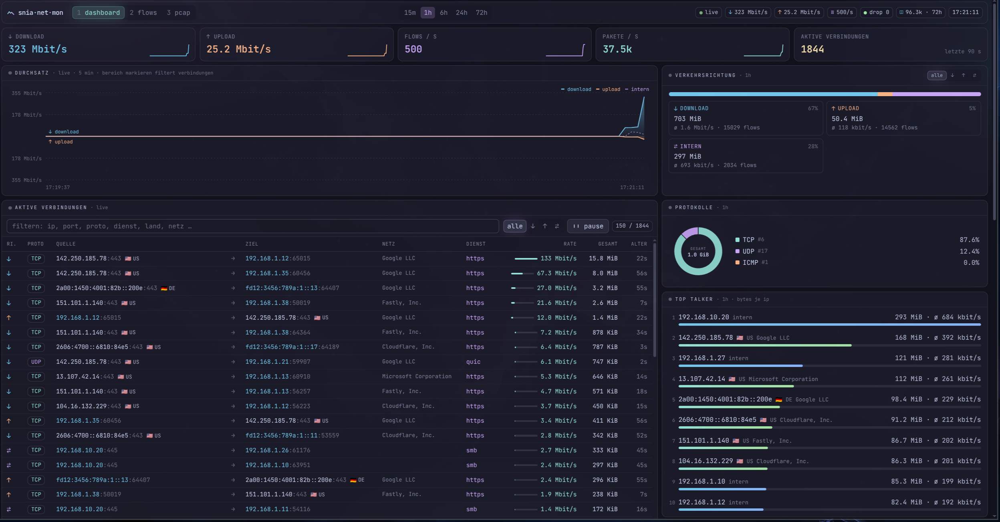

# Snia-Net-Mon

Netzwerkmonitor für eine **pfSense-Firewall**. Er sammelt Verbindungsdaten per **NetFlow v9 / IPFIX**, zeigt sie live im Browser – mit
**GeoIP (Land, ASN)** für jede externe Gegenstelle – und macht sie durchsuchbar. Dazu kommt eine **PCAP-Analyse** für
Mitschnitte (pcap/pcapng). Alle Daten werden nach spätestens **72 Stunden automatisch und unwiderruflich gelöscht**.

- **Backend:** Rust (Tokio, Axum), SQLite im WAL-Modus
- **Frontend:** Svelte 5 + Tailwind, Catppuccin-Mocha-Theme im Hyprland-Look (Frosted Glass, Verlaufskanten, Monospace)
- **Status:** Prototyp – funktionsfähig und getestet, siehe [Grenzen & nächste Schritte](#grenzen--nächste-schritte)



## Funktionen

| Bereich | Was es kann |
|---|---|
| **Dashboard** (`#dashboard`) | Live-Durchsatz getrennt nach **Download ↓ und Upload ↑** (gespiegelter Chart) per WebSocket, Verkehrsrichtung im Zeitfenster, Tabelle der aktiven Verbindungen mit Richtung (einfrierbar, filterbar). **Bereich im Durchsatz-Chart mit der Maus markieren** hält Chart und Tabelle an und zeigt die Verbindungen genau dieses Zeitraums (Klick oder Esc = zurück zu live), Top Talker, Top Ports, **Länder und Netze (ASN)** der Gegenstellen, Protokollverteilung, Sankey-Diagramm Quelle → Dienst → Ziel. Alle Statistiken lassen sich nach Richtung filtern |
| **Flow-Suche** (`#flows`) | Filter nach IP **oder CIDR** (Quelle/Ziel/beides), Port, Protokoll, Richtung, Zeitfenster; CSV-Export. Darunter die **Top Talker grafisch** mit ihren stärksten Gegenstellen (Dienst, gesendet/empfangen). Klick auf eine IP im Dashboard springt direkt hierher |
| **PCAP** (`#pcap`) | Capture-Datei (pcap/pcapng, z. B. aus *Diagnostics → Packet Capture*) per Drag & Drop hochladen: Kennzahlen, Zeitverlauf, Protokolle, **Anwendungen** (YouTube, Microsoft 365, CDN, AI … über TLS-SNI, DNS, HTTP-Host, IP-Präfixe), **Endpunkte mit Land und ASN**, Länder, Top Quellen/Ports/Flows, DNS, HTTP, TCP-Flags und heuristische **Auffälligkeiten** (Portscan, NXDOMAIN-Häufung, DNS/HTTP auf Nicht-Standard-Ports). Verlauf der Analysen; Klick auf eine IP sucht sie in den NetFlow-Daten |
| **GeoIP** | Land, Organisation und ASN für alle öffentlichen IPs – in der Live-Tabelle, Flow-Suche (auch CSV), Top Talker, Sankey und PCAP-Analyse |
| **Retention** | harte Obergrenze 72 h für Flows und PCAP-Analysen (die hochgeladene Datei selbst wird direkt nach der Analyse gelöscht); Abfragen liefern nie ältere Daten, auch bevor der Cleanup gelaufen ist |

Tastatur wie in Hyprland: **Alt+1 / Alt+2 / Alt+3** wechselt den Workspace. Der Fokus folgt der Maus: Das Fenster unter dem Zeiger
bekommt die aktive Verlaufskante.

## Schnellstart (Demo ohne pfSense)

Voraussetzungen: Rust ≥ 1.88, Node ≥ 20.

```bash
cd frontend && npm install && npm run build && cd ..
cargo run --release --bin snia-net-mon          # Web-UI: http://127.0.0.1:8080
cargo run --release --bin flowgen               # zweites Terminal: erzeugt Demo-Verkehr
```

Ohne `config.toml` laufen Standardwerte: Collector auf UDP 2055, Web-UI nur lokal auf Port 8080.
`flowgen` schickt echte NetFlow-v9-Pakete an den Collector. Optionen: `--rate 5000`, `--format ipfix`,
`--exporters 4`, `--seconds 60`.

### GeoIP-Datenbanken

Länder und ASN kommen aus den kostenlosen **MaxMind GeoLite2**-Datenbanken (Lizenz beachten – die Dateien gehören nicht
ins Repository). Ohne die Dateien läuft alles weiter, nur die Geo-Felder bleiben leer. Das Datum der geladenen Ausgabe
steht in der Fußzeile der Web-UI.

**Automatisch (empfohlen):** Auf [maxmind.com](https://www.maxmind.com/en/geolite2/signup) kostenlos registrieren, unter
*Account → Manage License Keys* einen Lizenzschlüssel erzeugen und Konto-ID und Schlüssel eintragen – entweder in
`config.toml` oder als Umgebungsvariablen (dann steht der Schlüssel nicht in der Datei):

```toml
[geoip]
account_id = "123456"
license_key = "abc123_…"
```

```bash
MAXMIND_ACCOUNT_ID=123456 MAXMIND_LICENSE_KEY=abc123_… cargo run --release --bin snia-net-mon
```

Der Server holt fehlende Datenbanken beim Start und prüft danach alle `update_interval_hours` (Standard 24) auf eine neue
Ausgabe (MaxMind veröffentlicht zweimal pro Woche). Die Prüfung per HEAD-Request zählt nicht gegen das Download-Limit;
geladen wird nur, was neuer ist. Die neue Datei wird geprüft, atomar ersetzt und **ohne Neustart** übernommen.

**Manuell oder mit `geoipupdate`:** `GeoLite2-Country.mmdb` und `GeoLite2-ASN.mmdb` nach `data/` legen (Pfade über
`[geoip]` änderbar). Ersetzte Dateien – auch durch MaxMinds Tool `geoipupdate` per Cron – erkennt der Server innerhalb von
10 Minuten und lädt sie neu.

## Anbindung an die pfSense

### NetFlow-Export (softflowd)

1. **System → Package Manager → Available Packages:** `softflowd` installieren.
2. **Services → softflowd:**
   - *Interface:* die zu überwachenden Interfaces (z. B. LAN, WAN)
   - *Host:* IP des Rechners mit Snia-Net-Mon, *Port:* `2055`
   - *NetFlow version:* `9` oder `IPFIX (10)`
   - *Flow tracking level:* `Full` (5-Tupel mit Ports)
   - *Flow Timeouts:* kurze Werte ergeben „livere“ Daten, z. B. `maxlife 60`
3. Speichern. Nach kurzer Zeit erscheinen die Flows im Dashboard. Solange der Exporter seine Templates noch nicht erneut
   gesendet hat, zählt der Collector die Daten als `missing_template` (Zähler unter `/api/status`).

## Download / Upload (Verkehrsrichtung)

Jeder Flow bekommt beim Empfang eine Richtung. Grundlage ist die Liste der internen Netze (`network.local_networks`):

| Richtung | Bedeutung | Beispiel |
|---|---|---|
| `in` ↓ Download | extern → intern | Antwort eines Webservers, Portscan auf einen weitergeleiteten Server |
| `out` ↑ Upload | intern → extern | Anfrage eines Clients, Cloud-Backup |
| `internal` ⇄ | intern ↔ intern | SMB zwischen LAN und Server-VLAN |
| `external` | weder noch | sollte selten vorkommen; häufig ein Hinweis, dass ein eigenes Netz in der Liste fehlt |

softflowd exportiert jede Verbindung als zwei Flows (Anfrage und Antwort). Deshalb erscheint ein Download als großer `in`-Flow
plus kleiner `out`-Flow. Der Dienst (Top Ports, Sankey, Spalte „Dienst“) ist jeweils der kleinere der beiden Ports, also 443
und nicht der zufällige Client-Port.

Standardmäßig gelten die privaten Bereiche (RFC 1918, CGNAT, Link-Local, IPv6-ULA) als intern. Mit **öffentlichem IPv6** vom
Provider muss dessen Präfix in `local_networks` ergänzt werden, sonst läuft IPv6-Verkehr unter „extern“. Dasselbe gilt für die
WAN-Adresse, wenn Verbindungen zur Firewall selbst als Download zählen sollen. Die Richtung wird beim Empfang gespeichert. Eine
geänderte Liste wirkt daher nur auf neue Flows, alte sind nach spätestens 72 h ohnehin gelöscht.

## Konfiguration

Eine einzige Datei: `cp config.example.toml config.toml`. Alle Schlüssel sind dort kommentiert. Die wichtigsten:

| Schlüssel | Standard | Bedeutung |
|---|---|---|
| `server.listen` | `127.0.0.1:8080` | Web-UI/API. Für Zugriff aus dem Netz `0.0.0.0:8080` **und** `api_token` setzen |
| `server.api_token` | leer | Zugriffsschutz: Die Web-UI fragt einmal nach dem Token |
| `network.local_networks` | private Bereiche | interne Netze für Download/Upload-Erkennung (siehe oben) |
| `collector.listen` | `0.0.0.0:2055` | Empfang von NetFlow/IPFIX |
| `collector.workers` | `2` | parallele Empfangs-Sockets (`SO_REUSEPORT`) |
| `storage.retention_hours` | `72` | Aufbewahrung; Werte über 72 werden auf 72 begrenzt |
| `geoip.country_db` / `geoip.asn_db` | `data/GeoLite2-*.mmdb` | MaxMind-Datenbanken (siehe oben) |
| `geoip.account_id` / `geoip.license_key` | leer | Zugang für das automatische Update (oder `MAXMIND_ACCOUNT_ID` / `MAXMIND_LICENSE_KEY`) |
| `geoip.update_interval_hours` | `24` | wie oft nach einer neuen GeoLite2-Ausgabe gesucht wird |
| `pcap.max_upload_mb` | `512` | größte erlaubte Capture-Datei |
| `pcap.app_rules` | leer | eigene App-Regeln als JSON (Format wie `crates/pcap/apps.json`), leer = mitgelieferte Regeln |

Aufruf mit anderer Datei: `snia-net-mon /etc/snia-net-mon.toml`. Logging über `RUST_LOG`, z. B. `RUST_LOG=debug`.

## Architektur

```text
pfSense (softflowd) ──UDP 2055──▶ collector ──Batches──┬──▶ db: Writer-Thread ──▶ SQLite (WAL)
                                  (n Worker,            │        Retention-Task ──▶ DELETE > 72 h, secure_delete
                                   SO_REUSEPORT)        └──▶ api::LiveHub ──1×/s──▶ WebSocket ──▶ Browser
Browser ──REST──▶ api (Axum) ──▶ db (Abfragen, Lese-Pool) ──▶ geo (Land/ASN je IP, beim Ausliefern)
Browser ──PCAP-Upload──▶ api ──▶ pcap (Analyse im Blocking-Thread) ──▶ db (Ergebnis als JSON, 72 h)
```

```text
Snia-Net-Mon/
├── Cargo.toml                 Workspace (Abhängigkeiten zentral)
├── config.example.toml
├── crates/
│   ├── model/                 gemeinsame Typen: FlowRecord, Direction, LocalNetworks, IP↔16-Byte, CIDR, MAX_RETENTION_HOURS
│   ├── collector/
│   │   ├── parser.rs          NetFlow v9 + IPFIX: Template-Cache, Dekodierplan, Varlen/Enterprise-Felder
│   │   ├── listener.rs        async UDP-Worker, Batching, Backpressure ohne Blockieren
│   │   ├── metrics.rs         lock-freie Zähler
│   │   └── synth.rs           Encoder + Verkehrsmodell (Tests, flowgen)
│   ├── db/
│   │   ├── lib.rs             Writer-Thread, Lese-Pool, Retention-Task
│   │   ├── schema.rs          Tabellen, Indizes, Pragmas, Migrationen
│   │   ├── rollup.rs          Minuten-/Stunden-Aggregate, Zerlegung der Zeitfenster
│   │   ├── query.rs           Suche, Top Talker/Ports/Protokolle, Verbindungen, Gegenstellen, Zeitreihe, Sankey
│   │   └── pcap.rs            gespeicherte PCAP-Analysen
│   ├── geo/                   MaxMind-Lookups (Land, ASN), Erkennung öffentlicher Adressen
│   ├── pcap/
│   │   ├── reader.rs          PCAP- und pcapng-Leser (µs/ns, mehrere Interfaces, Byte-Reihenfolge)
│   │   ├── dissect.rs         Ethernet/VLAN, Raw-IP, SLL/SLL2, Loopback, pflog; IPv4/IPv6, TCP/UDP/ICMP
│   │   ├── dns.rs · tls.rs    DNS-Parser, TLS-SNI aus dem ClientHello
│   │   ├── apps.rs            App-Regeln (Domains, IP-Präfixe) + DNS-Learning; Standardregeln in apps.json
│   │   └── analyze.rs         Aggregation, Heuristiken, Ergebnis-JSON
│   ├── api/
│   │   ├── lib.rs             Axum-Router, Endpunkte, Geo-Anreicherung, Token-Prüfung, Auslieferung der SPA
│   │   ├── pcap.rs            Upload (gestreamt, größenbegrenzt), Verlauf
│   │   └── live.rs            Tabelle aktiver Verbindungen, 1-s-Snapshots per Broadcast
│   ├── server/                Binary snia-net-mon: Konfiguration + Verdrahtung, geordnetes Herunterfahren
│   └── flowgen/               Binary flowgen: Demo-/Lastgenerator
└── frontend/
    ├── tailwind.config.js     Catppuccin-Mocha-Palette, Glow, Verlaufskante, Animationen
    └── src/
        ├── app.css            Komponenten-Klassen: .window, .window-active, .chip, .btn, .table-flows …
        ├── lib/               API-Client, WebSocket-Store (Runes), Formatierung, UI-Zustand
        └── components/        Dashboard, BandwidthChart, LiveTable, SankeyChart, FlowSearch, TalkerConnections, PcapAnalyzer, GeoTag …
```

### Leistung bei hoher Paketrate

- **Empfang:** Jeder Worker hat einen eigenen Socket (`SO_REUSEPORT`) und einen eigenen Template-Cache, dadurch gibt es kein
  Locking. Der Kernel verteilt nach Quell-Tupel, ein Exporter landet also immer beim selben Worker. Der Empfangspuffer ist
  standardmäßig 16 MiB groß, dafür `net.core.rmem_max` erhöhen.
- **Parsen:** Templates werden beim Empfang einmal in einen Dekodierplan übersetzt. Datensätze werden ohne Allokationen pro
  Feld dekodiert.
- **Backpressure:** Flows gehen gebündelt per `try_send` an Datenbank und Live-Ansicht. Ist ein Abnehmer voll, werden Flows
  gezählt verworfen (`dropped_flows`), der UDP-Empfang blockiert nie.
- **Schreiben:** Ein eigener Thread schreibt mit vorbereitetem Statement. Unter Last fasst er alle wartenden Batches zu einer
  Transaktion zusammen (bis 50.000 Zeilen).
- **Live:** Ein Snapshot pro Sekunde wird einmal serialisiert und an alle Clients geteilt. Die Top-150-Auswahl läuft in O(n).

Gemessen (Release-Build, ein Desktop-Rechner, 4 Exporter): **1.000.000 Flows in 10 s (100.000 Flows/s) ohne Verluste und
ohne Parse-Fehler**.

### Voraggregation (Statistiken bei viel Verkehr)

Der Writer schreibt in derselben Transaktion wie die Flows Summen **je Minute und je Stunde**: pro IP, pro Dienst
(Protokoll + Dienst-Port) und pro Paar Quelle → Ziel je Dienst, jeweils mit Richtung. Eine Statistik-Abfrage zerlegt ihr
Zeitfenster in volle Stunden, volle Minuten und die Ränder darunter. Nur die Ränder (unter einer Minute) kommen aus den
Einzel-Flows. Das Ergebnis ist **exakt dasselbe** wie über die Rohdaten (per Test gegen die Rohdaten geprüft).

- Aus den Aggregaten kommen: Top Talker, Länder/ASN, Top Ports, Protokolle, Richtungen, Zeitreihe, Sankey und die
  Gegenstellen der Flow-Suche – solange nur Zeitfenster und Richtung gefiltert werden.
- Mit IP-, Port- oder Protokollfilter sowie für Einzel-Flows und 5-Tupel-Verbindungen (markierter Bereich) wird wie bisher
  über die Rohdaten gesucht. Dafür gibt es Indizes, diese Abfragen betreffen nur einen kleinen Ausschnitt.
- Eine bestehende Datenbank bekommt die Aggregate beim ersten Start einmalig nachberechnet (Log: „Aggregat-Tabellen
  angelegt“). Bei einer großen Datei kann das einige Minuten dauern.
- Die Aggregate unterliegen derselben 72-h-Retention wie die Flows.

Lastprobe mit 1 h bei 1.000 Flows/s (3,6 Mio. Flows, 60 Geräte, 20.000 Gegenstellen), Zeitfenster 1 h, Release-Build:

| Abfrage | nur Rohdaten | mit Aggregaten |
|---|---|---|
| Top Talker / Länder | 8,4 s | 0,45 s |
| Top Ports | 1,8 s | 0,02 s |
| Protokolle / Richtungen | 0,7 s | 0,01 s |
| Sankey / Gegenstellen | 4,9 s | 1,7 s |

Schreiben: 135.000 Flows/s. Die Aggregate brauchen zusätzlich Platz. Wie viel, hängt davon ab, wie oft dieselben Paare
wiederkehren: bei diesen Testdaten mit sehr vielen einmaligen Gegenstellen rund die Hälfte der Rohdaten, im Heimnetz mit
immer denselben Diensten deutlich weniger. Nachmessen: `cargo test -p db --release -- --ignored bench --nocapture`
(Anzahl per `BENCH_FLOWS`).

### Retention (72 Stunden)

- `model::MAX_RETENTION_HOURS = 72` ist fest einkompiliert. Die Konfiguration kann den Wert nur verkleinern.
- Der Retention-Task läuft beim Start und danach jede Minute. Er löscht in Blöcken zu je 20.000 Zeilen
  (`DELETE … WHERE ts < now − 72 h`), damit der Writer nicht blockiert.
- **Unwiderruflich:** `PRAGMA secure_delete = ON` überschreibt gelöschte Inhalte in der Datei. Danach folgt
  `wal_checkpoint(TRUNCATE)`, damit nichts im WAL zurückbleibt, und `incremental_vacuum` gibt freie Seiten zurück.
- Jede Abfrage begrenzt das Zeitfenster zusätzlich auf die letzten 72 h. So erscheinen alte Daten auch zwischen zwei
  Cleanup-Läufen nie.
- PCAP-Analysen (sie enthalten IPs, Domains und URLs) werden nach derselben Frist gelöscht. Hochgeladene Capture-Dateien
  liegen nur während der Analyse als temporäre Datei in `pcap.upload_dir` und werden danach sofort entfernt – auch bei
  Fehlern; Reste nach einem Absturz räumt der nächste Start weg.

### Sicherheit

- Die Web-UI lauscht standardmäßig nur auf `127.0.0.1`. Für Netzzugriff `api_token` setzen und einen Reverse-Proxy mit HTTPS
  davorstellen. Der WebSocket akzeptiert das Token als `?token=`.

## API

| Methode | Pfad | Beschreibung |
|---|---|---|
| GET | `/api/status` | Collector-Zähler, DB-Statistik, Retention, GeoIP-Status |
| GET | `/api/flows` | Flow-Suche (mit `src_geo`/`dst_geo`). Parameter: `from`, `to` (Unix-ms), `ip`, `src`, `dst` (IP/CIDR), `port`, `proto`, `dir` (`in`/`out`/`internal`/`external`), `limit` (≤ 5000) |
| GET | `/api/stats/talkers` · `/ports` · `/protocols` | Aggregationen, gleiche Filterparameter |
| GET | `/api/stats/directions` | Bytes, Pakete, Flows und ø Bandbreite je Richtung |
| GET | `/api/stats/timeseries` | Zeitreihe mit `bytes_in`/`bytes_out` je Stützstelle, zusätzlich `points` |
| GET | `/api/stats/connections` | Verbindungen (5-Tupel) summiert über das Zeitfenster, nach Bytes sortiert, `limit` ≤ 2000 |
| GET | `/api/stats/peers` | Paare Quelle → Ziel je Dienst (`proto`, `port`; Client-Ports zusammengefasst) mit Geo, nach Bytes sortiert, `limit` ≤ 5000 |
| GET | `/api/stats/geo` | Verkehr externer Gegenstellen nach Land (`countries`) und ASN (`asns`), `limit` ≤ 50 |
| GET | `/api/stats/sankey` | Knoten/Kanten Quelle → Dienst → Ziel, `limit` = Anzahl Verbindungen |
| WS | `/api/live` | beim Verbinden `{"type":"history"}`, danach jede Sekunde `{"type":"tick"}` mit Rate (gesamt, `bytes_in`, `bytes_out`), aktiven Verbindungen inkl. Richtung, Zählern und GeoIP |
| POST | `/api/pcap?name=datei.pcap` | Capture-Datei als Rohdaten im Body (`curl --data-binary @datei.pcap`), liefert das Analyse-Ergebnis mit `id` |
| GET | `/api/pcap` · `/api/pcap/{id}` | Verlauf der Analysen / gespeichertes Ergebnis |
| DELETE | `/api/pcap/{id}` | Analyse löschen |

## Entwicklung

```bash
cargo test --workspace              # Parser-Roundtrips (v9/IPFIX), Fuzz-artige Robustheit, Retention, Filter, PCAP/pcapng-Leser, App-Regeln, GeoIP
cargo clippy --workspace --all-targets
cd frontend && npm run dev          # Vite auf :5173 mit Proxy auf das Backend (:8080), Hot Reload
```

## Grenzen & nächste Schritte

- **Skalierung:** Mit den Aggregaten bleiben die Statistiken auch bei ~1.000 Flows/s schnell. Grenze ist dann eher der
  Platz: 72 h Rohdaten bei 1.000 Flows/s sind ~50 GB. Nächste Schritte wären eine kürzere Aufbewahrung nur für die
  Einzel-Flows (Aggregate weiter 72 h) oder für sehr hohe Raten DuckDB/ClickHouse. Die Schnittstelle des `db`-Crates ist
  dafür ausgelegt.
- **Partitionierung:** Jeder Datensatz trägt seinen Stunden-Bucket, gelöscht wird über den Zeitindex. Echte Stunden-Tabellen
  mit `DROP TABLE` wären bei sehr großen Datenmengen schneller.
- **NetFlow v5 / sFlow** werden nicht unterstützt, softflowd kann v9/IPFIX.
- **Zeitstempel:** Flows werden nach ihrem Ende (`ts`) einsortiert. Lange Flows erscheinen im Durchsatz-Chart daher als Spitze
  zum Exportzeitpunkt, wie bei NetFlow üblich.
- **PCAP-Analyse** erkennt Anwendungen nur über unverschlüsselte Merkmale (SNI, DNS, HTTP-Host). Mit ECH (Encrypted Client
  Hello) oder DNS-over-HTTPS sinkt die Trefferquote. Die Analyse hält pro Paket nur einen Zeitstempel im Speicher, sehr große
  Mitschnitte (Hunderte Millionen Pakete) brauchen entsprechend RAM.
- **GeoIP** wird beim Ausliefern nachgeschlagen, nicht gespeichert – ein Datenbank-Update wirkt daher auch auf ältere Flows.
- **Kein Benutzer-/Rollenkonzept**, nur ein gemeinsames API-Token.

## Lizenz

[MIT](LICENSE) – frei nutzbar, veränderbar und weitergebbar, solange der Copyright-Hinweis erhalten bleibt. Ohne Gewährleistung.
